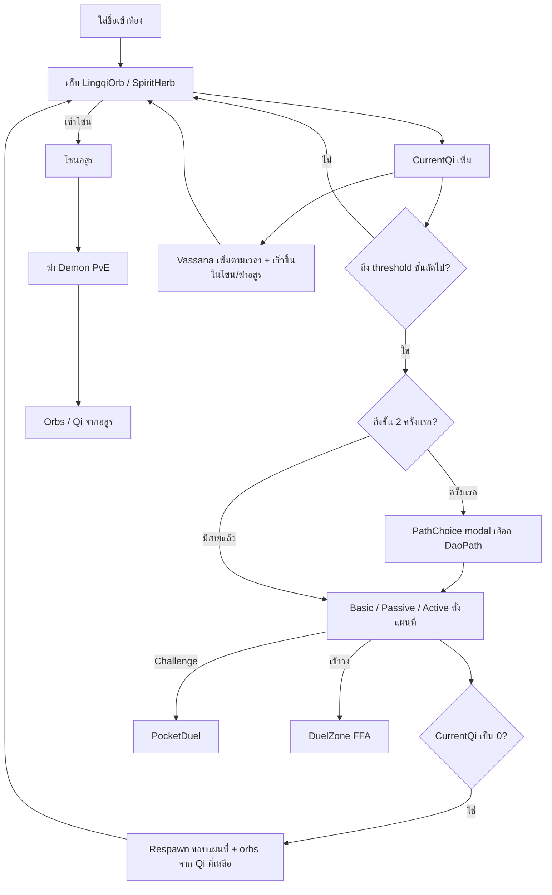

# Spec: Xian IO (Web Multiplayer MVP)

**Status:** Draft for implementation  
**Vocabulary:** ใช้คำจาก [`CONTEXT.md`](../CONTEXT.md) (สร้างพร้อม scaffold)  
**MVP target:** Local demo — หลายแท็บ / LAN, ไม่มี account, ห้องเดียว ~32 คน

---

## 1. เป้าหมาย

เกม .io บนเว็บ ธีมเทพเซียน (อ้างอิงขั้นฝึกแบบ *ฝืนลิขิตฟ้า*):

- เก็บลมปราณ ขึ้นขั้นฝึก ต่อสู้ทั้งแผนที่
- เลือก **DaoPath** ครั้งเดียวเมื่อถึงขั้น「สร้างฐานปราณ」
- ดวลแบบ **PocketDuel** (opt-in) และ **DuelZone** (FFA)
- **โซนอสูร (DemonZone)** — PvE ฆ่าอสูรของดี
- **วาสนา (Vassana)** — ดวง/โชค ส่งผลการดรอป

**ความสำเร็จของ MVP:** `pnpm dev` แล้วเล่น 2+ client ได้ — รวมเข้าโซนอสูร, ฆ่าอสูร, เห็นวาสนาขึ้นและของดรอปดีขึ้น, บวก loop เดิม (realm, สาย, ดวล)

---

## 2. นอกขอบเขต (MVP)

- Login, persistence ข้าม session, matchmaking หลาย region
- Redis, anti-cheat ขั้นสูง, deploy production
- Respec DaoPath
- Spawn shield หลัง respawn
- Peace nick แยกจาก combat (ยกเลิกแล้ว)

---

## 3. ประสบการณ์ผู้เล่น

---

## 4. โมเดลพลังและขั้นฝึก

### 4.1 CurrentQi, RealmFloor และ QiLayer

| แนวคิด | กติกา |
|--------|--------|
| **CurrentQi** | ค่าเดียวใน UI เรียก「พลังปราณ」— ใช้เป็นชีวิตและคะแนน leaderboard |
| **ความเสียหาย** | ลด CurrentQi (basic, skill, DoT, passive) |
| **Heal** | เก็บ LingqiOrb, SpiritHerb, respawn fill ตาม rule |
| **RealmFloor** | ขั้นฝึกสูงสุดที่เคยถึงในห้อง (1–25 ตาม `CULTIVATION_CATALOG`) |
| **QiLayer** | ชั้นย่อย 1–15 เฉพาะเมื่อ RealmFloor = 1 (หนิngชี่ / 凝气) |
| **Promotion** | Server เรียก `promoteCultivation` — บนขั้น 1 เลื่อน QiLayer ก่อน; ถึงชั้น 15 + threshold จึงขึ้นขั้น 2; ขั้น 2+ เลื่อน RealmFloor ตาม threshold จนถึง 25 |
| **Demotion** | เฉพาะแพ้ **PocketDuel** — `demoteCultivation` (ขั้น >2 ลง 1; ขั้น 2 → 1 ชั้น 15; ขั้น 1 ลดชั้น) |

### 4.2 ขั้นฝึก (แคตตาล็อกเดียวใน `packages/shared`)

- ยี่สิบห้าขั้นเรียงตาม *ฝืนลิขิตฟ้า* (หนิngชี่ → 踏天) พร้อมชื่อไทย/จีน, `majorStep`, `kind` (cultivation / transition)
- UI ขั้น 1: `realmDisplayName` → 「รวมลมปราณ · ชั้น N」
- **DaoPath / PathChoice** ยัง legacy จน SkillDraft (xian-10); combat tier ใช้ `effectiveCombatTier` (cap 7)

### 4.3 Stat ตามขั้นฝึก (ค่าตัวเลขใน `packages/shared`)

- **MaxQi** — ขั้น 1 ตาม QiLayer; ขั้น 2+ ตาม RealmFloor (`maxQiForRealm`)
- **MoveSpeed** — ตาม effective stat tier (ชั้นย่อยบนขั้น 1, floor บนขั้น 2+)
- **PickupRadius** — `orbPickupRadiusForCultivation` / herb variant
- **BodyRadius / สี aura** — ตาม `majorStep` ในแคตตาล็อก

### 4.4 ความตาย (ทุกที่บนแผนที่)

1. CurrentQi → 0  
2. Qi ที่เหลือก่อนตาย (ตาม rule) **ระเบิดเป็น LingqiOrb** บนตำแหน่งตาย  
3. Respawn ที่ขอบแผนที่, CurrentQi = `RESPAWN_QI` (constant)  
4. ไม่มี invulnerability

---

## 5. ทรัพยากรบนแผนที่

### 5.1 LingqiOrb

- Spawn ต่อเนื่อง server-side
- ชน/เข้า radius → เพิ่ม CurrentQi (cap ที่ MaxQi ของ tier ปัจจุบัน)

### 5.2 SpiritHerb

- Spawn หายาก
- เก็บแล้ว: CurrentQi เล็กน้อย + **HerbBuff** ~10 วิ
- **HerbBuff ตาม DaoPath:** กระบี่ +speed, กaya −damage taken, อัคนี +AoE radius, เงา +poison tick rate
- **Vassana modifier:** ตอนเก็บ orb/herb server ทอยเพิ่ม — โอกาส Qi bonus / herb คุณภาพสูง ↑ ตาม Vassana

---

## 5b. วาสนา (Vassana)

| แนวคิด | กติกา |
|--------|--------|
| **ความหมาย** | ดวงชะตา / โชคลาภ **ไม่ใช่** karma บาป-บุญจากฆ่าผู้เล่น |
| **การเพิ่ม** | **Passive:** +ค่าต่อวินาทีที่อยู่ในห้อง; **เร่ง:** ยืนใน DemonZone และ/หรือ **ฆ่า Demon** (ตัวคูณเร็วกว่าแผนที่เปิด) |
| **ขอบเขต** | 0 … `VASSANA_CAP` (เช่น 100) — reset เมื่อออกจากห้อง |
| **ผล** | ปรับ roll เมื่อ `applyOrbPickup` / spawn herb ที่เกี่ยวกับผู้เล่น: โอกาส orb มูลค่าสูง, SpiritHerb โผล่ใกล้ตัว (MVP: อย่างน้อย **bonus Qi %** บน orb) |
| **UI** | แถบ「วาสนา」ใต้ชื่อ หรือไอคอนดวง |

**ไม่ทำใน MVP:** วาสนาลดจากฆ่าผู้เล่น, ระบบเความลิขิต (quest chain)

---

## 5c. อสูรและโซนอสูร (Demon / DemonZone)

### โซน

- แผนที่มี **2–3 DemonZone** (วง/polygon ชัดเจน — tint + ขอบ)
- โซนลึก/กลางแผนที่: อสูร **แรงกว่า** ดรอป **ดีกว่า**
- นอกโซน: ไม่ spawn อสูร (หรือ spawn น้อยมาก — MVP: **เฉพาะในโซน**)

### Demon (PvE)

| ฟิลด์ | กติกา |
|---------|--------|
| **ชีวิต** | `CurrentQi` ของอสูร (ไม่มี RealmFloor / DaoPath) |
| **AI MVP** | ในโซน: เดินหา player ใกล้สุด → โจมตีระยะใกล้ / ชน (damage CurrentQi) |
| **เป้าหมายผู้เล่น** | ใช้ combat kit เดียวกับ PvP (basic/skill ทำ damage กับ demon entity) |
| **ตาย** | ระเบิด **LingqiOrb** มูลค่าสูงกว่า orb ทั่วไป; ไม่โอน % แบบ PocketDuel |
| **Respawn** | Server respawn demon ในโซนเมื่อต่ำกว่า quota |

### ประเภท (MVP อย่างน้อย 2)

1. **อสูรป่า** — Qi ต่ำ damage ต่ำ drop ปานกลาง  
2. **อสูรโซนลึก** — Qi สูง damage สูง drop ดี (SpiritHerb roll เพิ่ม)

### PvP ในโซน

- ผู้เล่นต่อสู้กันใน DemonZone ได้ตามปกติ (Qi=HP ทั้งแผนที่)

---

## 6. DaoPath

### 6.1 การปลดล็อก

- **RealmFloor < 2:** `daoPath = null` — ไม่มี combat สาย (เคลื่อนที่ + เก็บของ)
- **RealmFloor ≥ 2 ครั้งแรก:** `awaitingPathChoice = true` → modal 4 ทาง → เลือกแล้ว **ถาวรในห้อง**
- **RealmFloor ตก < 2:** จำ `daoPath` — **kit ยังใช้ได้** (ไม่เปิด modal ใหม่)

### 6.2 การควบคุม (client → server)

| Input | การใช้ |
|-------|--------|
| WASD / stick | เคลื่อนที่ |
| Cursor | ทิศทาง / พิกัดเป้า |
| LMB | Basic Attack |
| Shift หรือ RMB | Active Skill (ตามสาย) |
| ปุ่ม Challenge | ส่งคำขอ PocketDuel |

### 6.3 สายที่ 1 — วิชากระบี่บิน (剑修)

**PX:** จอมยุทธ์ลื่นไหล คุมกระบี่

| ชิ้น | พฤติกรรม |
|------|-----------|
| Basic | คลื่นกระบี่รูปพัด (fan, medium range) → damage CurrentQi |
| Passive | **FlyingSwords** จำนวน `min(5, max(0, RealmFloor − 1))` โคจร โจมตีเป้าใกล้ auto (server) |
| Active **Shift** | Dash ไปข้างหน้า + รอยฟันตามเส้นทาง → damage |

### 6.4 สายที่ 2 — กายาทองคำ / หลอมกายา (体修)

**PX:** ถึก ปะทะกลางแผนที่

| ชิ้น | พฤติกรรม |
|------|-----------|
| Basic | Melee ระยะใกล้ + **Stagger** (ดันเป้า) |
| Passive | ลด incoming damage 20%; **Stun immune** ขณะ CurrentQi > 50% MaxQi |
| Active **RMB** | โล่ 1.5s — ลด damage; ถ้าโดนระหว่างโล่ **reflect 50%** |

### 6.5 สายที่ 3 — เต๋าอัคนีอัสนี (法修)

**PX:** burst สะใจ ตัวบาง CD นาน

| ชิ้น | พฤติกรรม |
|------|-----------|
| Basic | Bolt single-target damage สูง |
| Passive **Overload** | ใช้ skill สะสม stack; ครบ 3 → skill ถัดไป **crit 100%** แล้ว reset |
| Active **RMB** | ฟ้าผ่าที่ cursor — AoE + **Stun 0.5s** |

### 6.6 สายที่ 4 — คาถาเงาดรรชนีพิษ (毒魔)

**PX:** ซุ่ม DoT แล้วถอย

| ชิ้น | พฤติกรรม |
|------|-----------|
| Basic | ระยะไกล + **Poison** stack สูงสุด 5 → DoT ลด CurrentQi |
| Passive | ไม่โดน damage 3s → +25% speed + VFX โปร่งแสง |
| Active **Shift** | Warp หลังเป้า + **Slow 50%** ช่วงสั้น |

### 6.7 Status effects (server authoritative)

`Stagger`, `Stun`, `Slow`, `Poison`, `Shield`, `Dash`, `HerbBuff` — tick ที่ 20 Hz; client แสดง icon/ข้อความไทย

---

## 7. ระบบดวล

### 7.1 Challenge → PocketDuel

- Mutual opt-in (ทั้งสองยอม)
- **ห้าม** เริ่มขณะอยู่ใน DuelZone
- ย้ายทั้งคู่ไป **pocket instance** (แยก simulation)
- จบ: กลับตำแหน่งเดิมบนแผนที่หลัก
- **ชนะ:** ฝ่ายใด CurrentQi → 0
- **แพ้:** โอน **40%** CurrentQi ของผู้แพ้ให้ผู้ชนะ; RealmFloor −1 (min 1); respawn ตามกติกาทั่วไป

### 7.2 DuelZone (FFA)

- เข้าวง → ต่อสู้ FFA ด้วย combat kit ปกติ
- CurrentQi → 0 → **เตะออกวง** + respawn ขอบแผนที่
- Qi ก่อนตาย **ระเบิดเป็น LingqiOrb** (ไม่ให้ last-hit โดยตรง)

---

## 8. สถาปัตยกรรม

### 8.1 Stack

- **Monorepo (pnpm):** `apps/client`, `apps/server`, `packages/shared`
- **Client:** Vite + Phaser 3 + TypeScript
- **Server:** Colyseus + `@colyseus/schema` + TypeScript
- **Tests:** Vitest ใน `packages/shared` และ `apps/server` (logic ไม่พึ่ง canvas)

### 8.2 Authority

- Server **20 Hz** simulation
- Client: input + interpolation/prediction (optional slice หลัง sync พื้นฐาน)
- ทุก damage, Qi, realm, status, duel state คำนวณฝั่ง server

### 8.3 Room state (ย่อ)

- `players[]`: id, name, x, y, CurrentQi, RealmFloor, **vassana**, daoPath, flags, buffs
- `orbs[]`, `herbs[]`, `projectiles[]`
- **`demons[]`**, **`demonZones[]`**
- `duelZones[]`
- `pocketDuels[]` (หรือ room ย่อย / partition state)

### 8.4 Dev & LAN

- `pnpm dev` รัน client + server
- Server bind `0.0.0.0` สำหรับ LAN
- Client env `VITE_SERVER_URL`

---

## 9. UI / ศิลป์

- ภาษา **ไทยล้วน**
- Vector geometric — สีออร่าตาม RealmFloor + accent ตาม DaoPath
- กล้อง **ตามตัว** (classic .io)
- Leaderboard ในห้อง: ชื่อ, RealmFloor, CurrentQi

---

## 10. Tracer bullets (implementation order)

| ID | Blockers | Done when |
|----|----------|-----------|
| xian-01-scaffold | — | `pnpm dev`, join ชื่อ |
| xian-02-room-sync | 01 | 2 client เห็นกันเคลื่อนที่ |
| xian-03-qi-orbs | 02 | เก็บ orb, leaderboard |
| xian-04-realm-tiers | 03 | 7 tier, speed/radius |
| xian-05-combat-core | 04 | damage, death→orbs, respawn, status framework |
| xian-05b-demons-vassana | 05 | DemonZone, demon AI, kill drops, Vassana tick + drop rolls |
| xian-06-dao-path | 05b | modal tier 2, 4 kits |
| xian-07-duel-flow | 06 | pocket + zone FFA |
| xian-08-xian-feel | 07 | vector + VFX + โซนอสูร tint |

**Playable demo:** หลัง xian-07

---

## 11. Acceptance tests (Vitest ตัวอย่าง)

- `applyOrbPickup` — Qi เพิ่มไม่เกิน MaxQi
- `promoteRealm` — threshold ขึ้น RealmFloor
- `applyDamageToQi` — CurrentQi ไม่ต่ำกว่า 0; ที่ 0 trigger death drop
- `poisonStacks` — สูงสุด 5, tick damage
- `overloadCrit` — stack 3 → next skill crit
- `tryStartChallenge` — reject ใน DuelZone
- `resolvePocketDuel` — 40% transfer + realm drop
- `tickVassana` — passive gain; multiplier ใน DemonZone
- `rollOrbWithVassana` — โอกาส bonus Qi
- `damageDemon` — demon Qi→0 → spawn orbs

---

## 12. ADR (เขียนตอน scaffold)

1. Pocket instance สำหรับ mutual duel  
2. Server authoritative combat  
3. CurrentQi เป็นทั้งชีวิตและ progression (RealmFloor แยก)

---

## 13. Balance constants (TBD ใน `packages/shared/balance.ts`)

เก็บทุกตัวเลขที่ปรับบ่อย: damage, CD, poison tick, orb value, realm thresholds, respawn Qi, reflect %, ฯลฯ — **ห้าม magic number ใน room logic**
